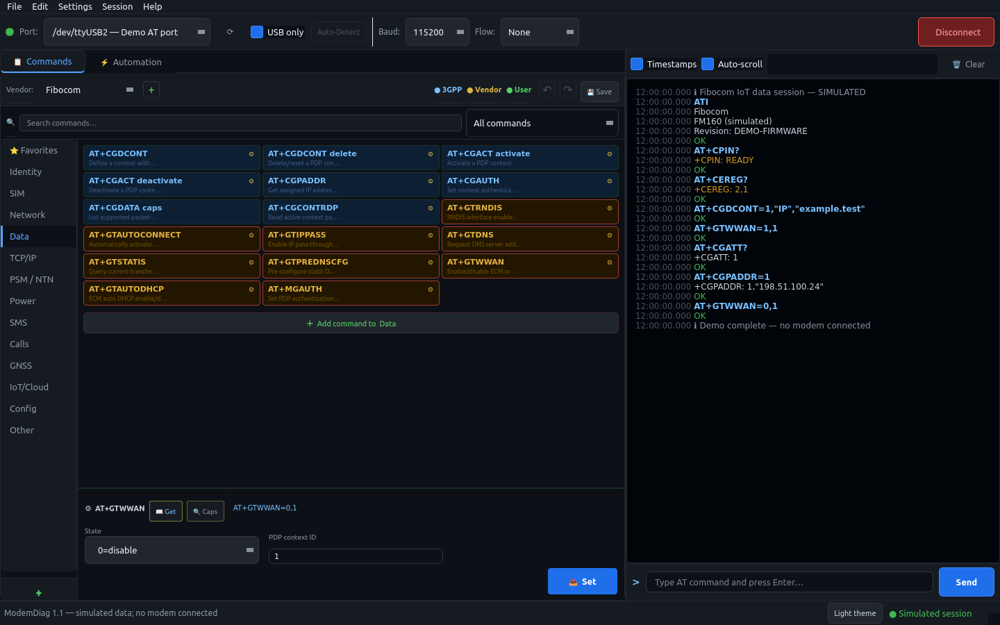
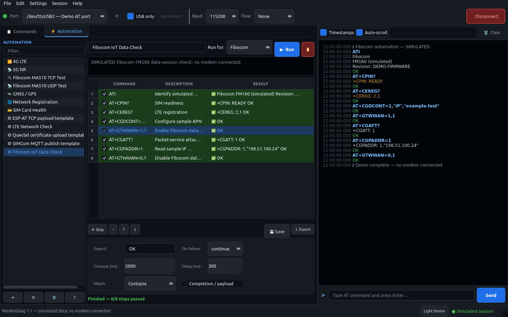

# ModemDiag

Version **1.1**

**An open-source AT command tester and diagnostic tool for cellular modems (LTE / 5G / NB-IoT / GNSS).**

ModemDiag is a desktop app (Python + PyQt6) for talking to cellular modules over a serial port. It gives you a colour-coded AT terminal, a library of one-click commands for the major module vendors, and an automation engine that runs scripted test sequences and reports pass/fail for each step.

ModemDiag is an independent project. Manufacturer and product names identify compatibility; no vendor
sponsorship, endorsement or certification is claimed. Trademarks belong to their respective owners.



[View the light theme](docs/fibocom-light.png).

---

## Features

- **Smart port detection**: polls for USB modems and labels each port by role (`AT`, `PPP`, `NMEA`, `DM`) using sysfs on Linux and the registry on Windows. The AT port is selected automatically, and an *Auto-Detect* button probes ports with `ATI`.
- **AT terminal**: colour-coded output (OK / ERROR / URC / data), timestamps, command history (↑ / ↓), and the modem's echo is hidden.
- **Command library**: 380+ entries grouped by function (Identity, SIM, Network, Data, TCP/IP, PSM/NTN, GNSS, SMS, Calls, IoT/Cloud, …)
  - 3GPP commands (blue) plus vendor-specific commands (amber) for **Quectel, Fibocom, Sierra Wireless, u-blox, Telit, SIMCom, Nordic and Espressif ESP-AT**
  - Optional model/firmware profiles show scoped command subsets; **All commands** keeps the complete library
  - Parameterised commands open an inline form with drop-downs, plus **Get** (read current value) and **Caps** (`=?`) buttons
  - Search, favourites, your own commands and categories, drag-and-drop reordering, and a renamable sidebar
  - Undo/redo command-library changes during the current session; edits keep descriptions and parameter controls
  - Add a vendor with **+** beside the vendor selector; new commands belong to the selected vendor
- **Automation**: build sequences with substring or regex expectations, completion/failure URCs, prompt-driven text or hex payloads, timeouts, delays and failure policies (`continue` / `stop` / `retry`). Ships with suites for LTE, 5G NR, SIM, network registration, GNSS and Fibocom MA510 TCP/UDP, plus configurable MQTT, certificate-upload and ESP-AT payload templates. Suites can be imported and exported as YAML.
- **Session logs**: every TX/RX line is written to a timestamped log file (*File → Save Log…*).
- **Cross-platform**: Linux and Windows, with a single-file executable built by PyInstaller.
- **Appearance**: switch between dark and light colors using the theme button in the status bar; your choice is remembered locally.
- **Licenses**: Help → Licenses shows licensing, warranty and support information, full release notices,
  and a link to matching source. Issues and licensing concerns can be reported through GitHub Issues.



<sub>Screenshots show a simulated session with sample data, not a capture from real hardware.</sub>

## Quick start (run from source)

Requires **Python 3.10+**.

```bash
git clone https://github.com/yassineflag/ModemDiag.git
cd ModemDiag
python3 -m venv .venv
source .venv/bin/activate          # Windows: .venv\Scripts\activate
pip install -r requirements.txt
python main.py
```

> **Linux serial permissions:** if you get `Permission denied` on `/dev/ttyUSB*`, add yourself to the `dialout` group (`sudo usermod -aG dialout $USER`), then log out and back in.
> On some distros, ModemManager also grabs modem ports. Stop it while testing: `sudo systemctl stop ModemManager`.

## Build a standalone executable

The build scripts create a virtual environment, install the dependencies and run PyInstaller with [`ModemDiag.spec`](tools/build/ModemDiag.spec).
On Windows, install **Python 3.13.3 x64** (matching the included native dependency review), then
double-click **`build.bat`**. It automatically loads the included Windows configuration and creates
the executable, binary ZIP and source ZIP. No separate build-input download, file copying or
PowerShell environment variable is needed. The first build needs internet access for dependencies
and their source/license records.

Use `build.bat --dev` for a Windows executable without release packaging. Development builds
collect installed license notices locally without downloading dependency sources.

| Platform | Command | Output |
|---|---|---|
| Linux | `chmod +x build.sh && ./build.sh` | `local-ignored/dist/ModemDiag` |
| Windows | Double-click `build.bat` | Executable and release ZIPs in `local-ignored\dist\` |

For distribution, run `./build.sh --release` on Linux or `build.bat` on Windows
(`build.bat --release` remains supported). Each release build creates a
binary ZIP and a separate source ZIP in `local-ignored/dist/`. Binary ZIPs contain only the executable
and `NOTICES.txt`, with their SHA-256 checksums recorded in the ZIP comment. The source ZIP contains
matching application files once, plus each included platform's build requirements, notices and
dependency-source records under `modemdiag/release/<platform>/`.

For a Linux x86_64 and Windows x64 release, publish exactly these three downloads together:

- `ModemDiag-1.1-linux-x86_64.zip`
- `ModemDiag-1.1-windows-x64.zip`
- `ModemDiag-1.1-source.zip`

A single-platform build initially puts only that platform's records in its source ZIP. To prepare
the shared source ZIP, first save/extract each platform's generated source ZIP in a separate ignored
directory. Then, from the matching source checkout, combine their metadata (this does not compile):

```bash
python tools/release_bundle.py source \
  --metadata local-ignored/release-input/linux/modemdiag/release/linux-x86_64 \
  --metadata local-ignored/release-input/windows/modemdiag/release/windows-x64
```

Both builds must have exactly matching project files. The tool rejects mixed source snapshots and
refuses to replace an existing shared source ZIP with fewer platforms. Keep both platform inputs
until publication; the individual build metadata directory is reused by subsequent builds. Review
the output platform list and publish the final source ZIP beside both binary ZIPs, with clear source
links and checksums in the release description. Keep the required dependency sources available too.
The standalone executable remains beside the ZIPs for local use; obsolete generated binary archives
for the same platform are cleaned after a successful build.

The first release build downloads dependency sources to collect their notices; later builds reuse
`local-ignored/cache/`. They are not copied into the release ZIP. Set `MODEMDIAG_SOURCE_CACHE` to choose the
cache location. Release files and downloaded sources stay outside Git.

The result is a single self-contained file, so the target machine doesn't need Python. PyInstaller doesn't cross-compile: build the Windows `.exe` on Windows and the Linux binary on Linux.

<details>
<summary>Maintainers: Windows native dependency review</summary>

A Windows release build inventories every bundled DLL/PYD, including files inside Python wheels.
The public bootstrap configuration in `tools/build/windows-x64/` includes pinned requirements,
the reviewed file hashes/source references and their redistributable notices. These three files
are included in every source ZIP, including one built on Linux. A shared release source ZIP also
exports its exact Windows build records under `release/windows-x64/`; the Windows launcher prefers
those records, then legacy review files beside `build.bat`, then the bootstrap configuration.
An explicitly set `MODEMDIAG_WINDOWS_REVIEW` remains available for maintainers who need an override.
Development builds (`build.bat --dev`) do not require a review. The inventory is generated at
`local-ignored/build/release/windows-native-inventory.json`; hashes change when dependencies change.

Keep private supporting evidence outside Git, for example in `local-ignored/review/`.
The shipped review contains public redistribution information only. When changing dependencies,
group the updated inventory entries by component using this structure:

```json
{
  "components": [{
    "component": "CPython",
    "version": "YOUR_EXACT_PYTHON_VERSION",
    "files": {"python3XX.dll": "SHA256_FROM_INVENTORY"},
    "notice_file": "python-license.txt",
    "redistribution_basis": "Applicable license and redistribution conditions checked",
    "sources": [{"component": "CPython", "version": "YOUR_EXACT_PYTHON_VERSION"}]
  }]
}
```

List every inventory file exactly once. `notice_file` is relative to the review JSON (or absolute)
and must contain the redistributable copyright/license notices. Source references must match the
release's component/version records. Additional sources also need `url` and `sha256` fields; the
builder downloads and verifies them. For a component legitimately distributed without source,
replace `sources` with a `source_exception` explaining the applicable license and why source is
not required. Do not put private correspondence or personal details in these public notice fields.
Include dependencies embedded inside libraries in the review, as well as the DLLs themselves.

Update the public build configuration, or set `MODEMDIAG_WINDOWS_REVIEW` to a replacement review's
path, then rerun `build.bat`. The resulting
`sources.json` inside the source archive records reviewed components and binary hashes; notices join
the existing `NOTICES.txt`. A successful check verifies the supplied records, not their legal conclusions.
Inspect and test the resulting executable on Windows before publishing it.

</details>

## Release status

ModemDiag checks a signed policy on GitHub at startup and every five minutes. Offline use is allowed
unless a previously accepted policy revoked this version. Revocation stops automation, disconnects
the modem and blocks modem operations; editing and saving remain available. A newer policy can
restore access without reconnecting automatically. Update notices alone do not block commands.
**View releases** opens the official download page; installation is manual.
**Help → Release status…** shows the current decision. No AT traffic, logs or device identifiers
are uploaded; GitHub receives the normal HTTPS request, including its source IP address.
Older builds without the checker cannot be remotely disabled, and modified clients can bypass it.

<details>
<summary>Maintainers: signing updates and revocations</summary>

Maintainers can revoke official releases using the signed `release-policy.json` file on the repository's
`main` branch. The application pins its public verification key in `src/modemdiag/core/release_policy.py`. Keep the
private signing key outside the repository, back it up securely, and never include it in a build.
For example, to revoke version 1.0.0, then later restore access:

```bash
python3 tools/release_policy.py sign --key /private/path/release-signing.pem --sequence 2 --revoke 1.0.0 --message "Please update this release."
python3 tools/release_policy.py sign --key /private/path/release-signing.pem --sequence 3
```

To announce a published update without blocking users, sign with `--latest-version X.Y[.Z]` (stable
two- or three-part versions only). For example, `--sequence 4 --latest-version 1.1.0` shows an update notice on older
versions. Add `--update-message "Your short release note"` if useful. Combine that announcement with
`--revoke 1.0.0` when that particular release must stop operating. Without a custom revocation message,
blocked users see “This version is no longer supported. Please update ModemDiag.” Only advertise a
version after its download is available. Pre-release builds do not receive automatic version comparisons.

Publish only the resulting `release-policy.json` after reviewing the intended decision; the tool does
not upload anything. Each command replaces the revocation list and update announcement: repeat `--revoke`
for every version that should stay blocked, or use `--revoke-all` for all versions using this key. Always increase
the sequence. The default signature validity is 90 days (`--valid-days` changes it); renew policies
before expiry. Expired network policies are ignored; cached revocations remain blocked. Give future
releases distinct version numbers. Replacing the pinned signing key requires distributing a new build.

</details>

## Where user data is stored

| | Running from source | Packaged executable |
|---|---|---|
| Favourites, custom commands, your automations, logs | `local-ignored/runtime/` | Linux: `~/.local/share/ModemDiag/`<br>Windows: `%APPDATA%\ModemDiag\` |

Updating or replacing the executable never deletes your customisations.

Open **Settings → Configuration location…** to see the exact folder used by your installation. Command edits, custom vendors and category layout are in `user_commands.yaml`; favourites are in `quick_send.yaml`. Changes are saved automatically. Green commands are user-added or edited commands.

The dark/light theme preference is stored separately in `appearance.json` in the same folder.

Use the **↶ / ↷** buttons or **Edit** menu to undo/redo library edits, removals, favourites and layout changes during the current session. This history ends when the application closes. Undo changes your library; it does not reverse commands already sent to a modem.

**Settings → Restore default command library…** restores bundled commands, default favourites, vendors and category layout after confirmation. Your automation files and logs are kept. The reset can also be undone during the same session.

## Usage

1. Plug in the modem, pick the port (the AT port is pre-selected when detected), set the baud rate (usually 115200), then click **Connect**.
2. **Commands tab**: choose the vendor and optional model/firmware profile, then click a command. Buttons marked ⚙ take parameters. Right-click a button to edit it, remove it or add it to Favourites.
3. **Automation tab**: select a suite and click **▶ Run**. Select a step to edit *Expect*, *Match*, *Timeout*, *Delay* and *On Failure*. Expand **Completion / payload** for asynchronous responses or raw input, then click **💾 Save**.
4. Type any AT command in the terminal at the bottom right and press Enter.

Press **F1**, or open **Help → How to Use…**, for a short guide to editing, drag-and-drop, parameters and automation. Drag a command onto another within the same category to swap them. Manual sends are blocked while automation is running so their responses cannot interfere with the sequence; disconnecting stops the sequence.

Vendor libraries cover several module families, and support varies by model and firmware. The model
selector beside Search filters to explicitly scoped entries; unscoped and legacy shortcuts remain in
**All commands**. Profiles are reference-based subsets, not hardware certification. Use **Caps** and
the manual matching your firmware before changing radio, band, USB or sleep settings.

SIMCom targets SIM7070/7080/7090 application data and MQTT interfaces. Nordic targets the nRF91x1
modem interface exposed by suitable AT-client firmware; additional Serial Modem application commands
are a separate interface. Espressif targets modules running **ESP-AT**, using its command UART through
a USB-to-UART adapter or a board exposing that UART over USB. The programming USB connector is not
always the AT interface. Ordinary ESP-IDF/Arduino firmware does not automatically provide ESP-AT.
Wi-Fi and Bluetooth LE entries appear under **Other**. ESP8266 profiles exclude BLE; ESP32 BLE
requires a BLE-enabled ESP-AT build. Cellular 3GPP commands are hidden for Espressif.

## Adding commands and test suites

Everything is plain YAML, so the libraries can be extended without touching any Python.

**Vendor commands**: `resources/commands/<vendor>.yaml`

```yaml
manufacturer: "Quectel"
color: "#1a9e4a"
profiles:
  ec2x: "EC2x family"
categories:
  - name: "Band & RAT"                       # mapped to a sidebar tab in src/modemdiag/ui/command_panel.py
    commands:
      - name: "AT+QCFG nwscanmode"
        command: "AT+QCFG=\"nwscanmode\",{mode},1"   # {id} placeholders are filled from params
        get:  "AT+QCFG=\"nwscanmode\""               # optional "Get" button
        caps: "AT+QCFG=?"                            # optional "Caps" button
        description: "RAT scan mode"
        profiles: [ec2x]                          # shown in this profile and All commands
        params:
          - id: mode
            label: "Scan mode"
            type: select                             # or omit for a free-text field
            options: ["0=Auto", "3=LTE only"]        # the text before "=" is sent
            default: "0=Auto"
```

**Automation suites**: `resources/diagnostics/*.yaml` (built-in) or `local-ignored/runtime/macros/*.yaml` (yours)

```yaml
name: "LTE Network Check"
description: "Verify registration and signal"
steps:
  - command: "AT+CPIN?"
    description: "SIM ready?"
    expect_regex: '^\+CPIN:\s*READY\s*$'  # Regex mode; legacy expect remains substring matching
    timeout_ms: 5000
    delay_ms: 300          # pause before the next step
    on_failure: stop       # continue | stop | retry
```

Use **Run for** to include one vendor's tagged steps alongside shared steps. Mixed-vendor suites start
with **Common only**; **All steps** explicitly runs every vendor's steps. Untagged custom steps always run.
Uncheck a step to keep it in the workflow while skipping execution. Existing module-specific command
forms are retained; confirmed syntax corrections are scoped to the documented module families.
A passing step means its configured response conditions were met. Built-in SIM readiness, attachment
and registration checks now validate response values; registration checks require home/roaming status
1 or 5. Other queries can still pass simply because the command succeeded. Custom macros retain
substring matching unless **Regex** is selected. A valid GNSS fix or remote delivery requires its own
explicit condition.

For asynchronous operations, set `wait_for` to a completion regex and optionally `fail_on` to a failure
regex. The runner waits for both the successful final response and the completion message, even when
the message arrives after `OK`. Timeouts cover the entire step; the runner does not poll automatically.

For MQTT publishing or certificate/file upload, set `prompt` and `payload`. `payload_encoding` is
`utf-8` or `hex`; `payload_ending` is `none`, `ctrl-z` or `crlf`. `{length}` in the command becomes the
payload byte count, excluding any selected ending. Bytes are sent once, after the prompt, without an
automatic newline. Set `final_ok: SEND OK` for ESP-AT TCP sends; ordinary commands default to `OK`.
The editor exposes these fields under **Completion / payload**. Stopping or timing out while the
module awaits input may require exiting its input mode manually using the module-specific procedure.

```yaml
command: 'AT+SMPUB="modemdiag/test",{length},0,0'
prompt: '>'
payload: hello
payload_encoding: utf-8
payload_ending: none
timeout_ms: 30000
on_failure: stop
```

> The **Fibocom MA510 TCP/UDP** examples use the placeholder APN `internet` and documentation address `203.0.113.10`. Replace them with your settings and matching firmware. Their original payload-send/read templates remain unchecked; configure the correct prompt, payload encoding and response conditions before enabling them. Command acceptance does not verify remote delivery.

Saving a bundled suite creates a local copy and keeps the default intact. New YAML suites in
`local-ignored/runtime/macros/` are ignored by Git and excluded from executable builds. The four
public `resources/macros/example_*.yaml` templates are packaged and seeded without overwriting your
saved copies. MQTT, certificate-upload and ESP-AT templates start unchecked until configured.
Keep proprietary manuals and captures outside the repository, and review files before sharing.

## Project structure

```
src/modemdiag/        Application Python code (core/ and ui/)
resources/           Bundled commands, diagnostics, example macro and icons
docs/                Screenshots and short third-party notice
.github/             Contribution guide
tests/               Offline regression tests
tools/               Build recipe, screenshot and release tools
main.py              Launcher: python main.py
build.sh / build.bat  Linux / Windows build launchers
requirements.txt     Python dependencies
release-policy.json  Signed release status at its existing public URL
local-ignored/       Local-only files, entirely ignored by Git
  runtime/           Settings, favourites, custom automations and logs
  dist/              Executable and one release ZIP
  build/             Temporary packaging files
  cache/             Download and packaging caches
  reports/           Local test and build output
  review/            Local review drafts
  backups/           Local history backups
```

Run from source with `python main.py`; after building, run `local-ignored/dist/ModemDiag` on Linux or
`local-ignored\dist\ModemDiag.exe` on Windows. Downloadable binaries belong in GitHub Releases rather than Git.
Source-run settings and logs live in `local-ignored/runtime/`. Existing settings from the old
project-root layout migrate there without overwriting an existing destination file. `.git/`, `.venv/`
and tool/editor configuration directories keep their conventional names; environments and local tool
settings remain ignored by Git.

Run the regression checks without hardware:

```bash
QT_QPA_PLATFORM=offscreen python3 -m unittest discover -v
```

## Disclaimer

Some commands change module configuration (bands, RAT, USB mode, firmware update, factory reset…). Read your module's AT command manual before sending commands you're not familiar with. Command descriptions are short summaries; availability and syntax can differ by module and firmware. Library entries are not a claim of hardware verification for every listed model.

## Feedback & contact

Found a bug, have a question, or want a command or module added?
Please [open an issue](https://github.com/yassineflag/ModemDiag/issues).

You can also reach me through my GitHub profile: [@yassineflag](https://github.com/yassineflag).

## Author

**Yassine El Harami**

## License

[MIT](LICENSE) © 2026 Yassine El Harami

ModemDiag's own source retains this MIT license. The combined open-source executable is distributed
under GPLv3 terms because it includes PyQt6. Third-party components retain their respective licenses
and copyright notices. Each binary ZIP includes one `NOTICES.txt` containing full license texts and
exact dependency-source links. Download `ModemDiag-1.1-source.zip` separately from the same release
page for the matching application source, build scripts and both platforms' build records.
See [third-party notices](docs/THIRD_PARTY_NOTICES.md) and Help → Licenses in the application.

AT-command features help users configure, test and communicate with compatible IoT devices. No
manufacturer sponsorship, endorsement or certification is claimed. The software is provided without
warranty, to the extent permitted by applicable law. Compatibility, continued maintenance and support
are not guaranteed. Report issues or licensing concerns through the project's
[GitHub Issues](https://github.com/yassineflag/ModemDiag/issues).

To retrieve dependency sources, extract the included source archive and run
`python3 tools/release_bundle.py fetch-sources` from its `modemdiag/` directory. The tool verifies the
recorded SHA-256 hashes and saves the archives in `local-ignored/third-party-source/`. Distribution patches are
included in the source links; use `dpkg-source -x <package>.dsc` to unpack Ubuntu source packages.
Keep the linked sources available for as long as you distribute the binary; cached archives provide
a fallback if an upstream URL needs to be replaced.

The top-level source manifest covers all included platforms; each platform's original manifest and
pinned requirements remain under `release/<platform>/`. The build scripts select the matching
requirements on Linux and Windows. Windows release rebuilds also reuse the exported native review;
changed DLL/PYD hashes still require a new review.

Before publishing, run `python3 tools/release_bundle.py verify-sources --check-links` from the project
or extracted source directory. It verifies source-archive hashes and checks current URL reachability;
the local report is `local-ignored/reports/source-verification.json`. Reachability checks do not
replace verifying the complete downloaded archives. LibYAML embedded in PyYAML is recorded separately.
