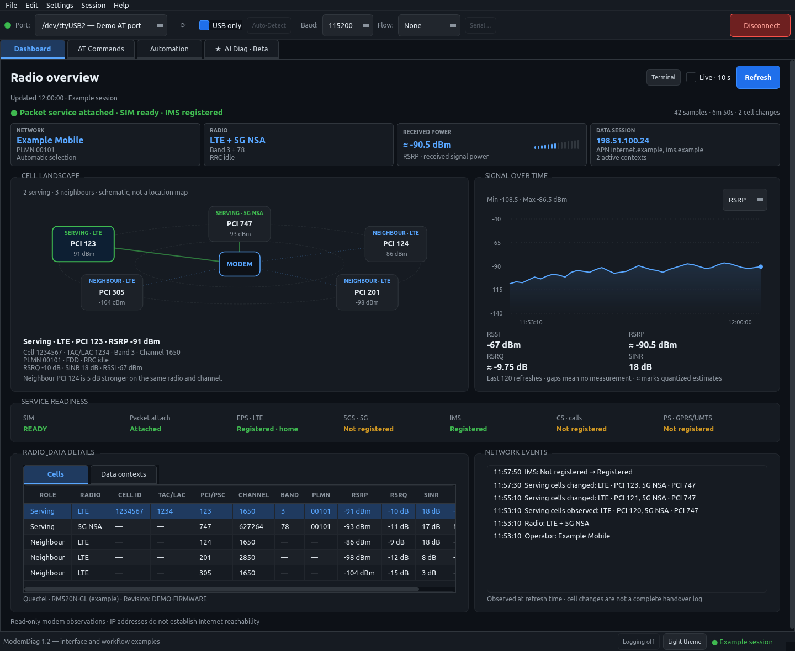
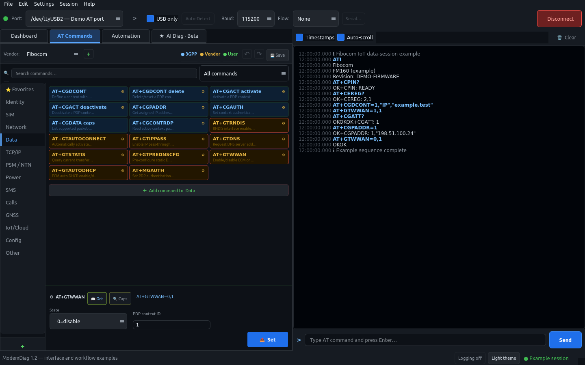
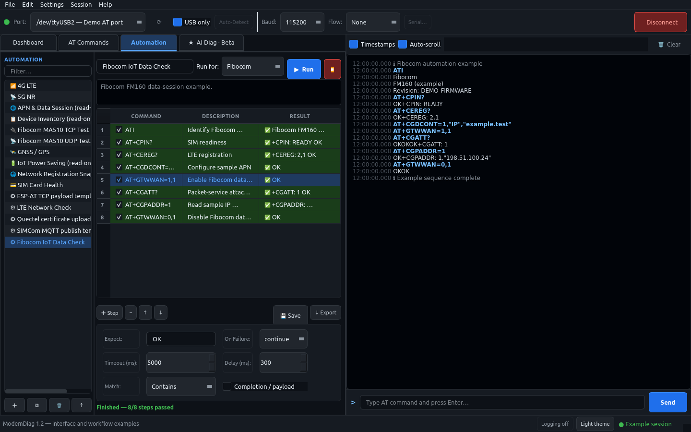

# ModemDiag

Version **1.2**

See [what changed from v1.1 to v1.2](docs/CHANGELOG.md), including the CRLF → CR default
command-ending change and the Windows folder-bundle instructions.

**An open-source AT command tester and diagnostic tool for cellular modems (LTE / 5G / NB-IoT / GNSS).**

ModemDiag is a desktop app (Python + PyQt6) for talking to cellular modules over a serial port. It gives you a network dashboard, a colour-coded AT terminal, a library of one-click commands for the major module vendors, and an automation engine that runs scripted test sequences and reports pass/fail for each step.

ModemDiag is an independent project. Manufacturer and product names identify compatibility; no vendor
sponsorship, endorsement or certification is claimed. Trademarks belong to their respective owners.

## Table of contents

- [Acknowledgements](#acknowledgements)
- [Features](#features)
- [Quick start (run from source)](#quick-start-run-from-source)
- [Build a standalone executable](#build-a-standalone-executable)
- [Release status](#release-status)
- [Where user data is stored](#where-user-data-is-stored)
- [Usage](#usage)
- [Adding commands and test suites](#adding-commands-and-test-suites)
- [Project structure](#project-structure)
- [Disclaimer](#disclaimer)
- [Feedback & contact](#feedback--contact)
- [Author](#author)
- [License](#license)

---

## Acknowledgements

Special thanks to **David Palma**, Director, IoT Technical Sales at **Fibocom**, and his team
for their contributions and testing of ModemDiag.

## Features

- **Smart port detection**: polls for USB modems and labels each port by role (`AT`, `PPP`, `NMEA`, `DM`) using sysfs on Linux and the registry on Windows. The AT port is selected automatically, and an *Auto-Detect* button probes ports with `ATI`.
- **Dashboard**: a full-width radio overview with an interactive serving/neighbour cell diagram, signal history, operator/PLMN, bands, channel, duplex and RRC state where reported. Includes RSSI/RSRP/RSRQ/SINR, SIM and CS/PS/LTE/5G/IMS registration, APN/IP data contexts and a session event feed. Click **Refresh** or enable **Live · 10 s**; **Terminal** opens the AT traffic beside the dashboard. Missing information is labelled **Not reported**.
- **AT terminal**: colour-coded output (OK / ERROR / URC / data), timestamps, command history (↑ / ↓), and the modem's echo is hidden.
- **Command library**: 380+ entries grouped by function (Identity, SIM, Network, Data, TCP/IP, PSM/NTN, GNSS, SMS, Calls, IoT/Cloud, …)
  - 3GPP commands (blue) plus vendor-specific commands (amber) for **Quectel, Fibocom, Sierra Wireless, u-blox, Telit, SIMCom, Nordic and Espressif ESP-AT**
  - Optional model/firmware profiles show scoped command subsets; **All commands** keeps the complete library
  - Parameterised commands open an inline form with drop-downs, plus **Get** (read current value) and **Caps** (`=?`) buttons
  - Search, favourites, your own commands and categories, drag-and-drop reordering, and a renamable sidebar
  - Undo/redo command-library changes during the current session; edits keep descriptions and parameter controls
  - Add a vendor with **+** beside the vendor selector; new commands belong to the selected vendor
- **Automation**: build sequences with substring or regex expectations, completion/failure URCs, prompt-driven text or hex payloads, timeouts, delays and failure policies (`continue` / `stop` / `retry`). Ships with suites for LTE, 5G NR, SIM, network registration, GNSS and Fibocom MA510 TCP/UDP, plus configurable MQTT, certificate-upload and ESP-AT payload templates. Suites can be imported and exported as YAML.
- **AI Diag ★ Beta**: the fourth tab connects to OpenAI or an OpenAI-compatible/local API for diagnostic chat, reviewed command plans and bounded automatic read queries. Preview the shared modem context, run selected steps and send their results back for analysis. API keys and conversations stay in memory; provider/model preferences are saved locally.
- **Session logs**: traffic, payloads and step results are saved continuously. The status bar and Session menu control recording; *File → Save Log…* exports a copy.
- **Configuration transfer**: export/import a ZIP containing saved commands, favorites, automations, theme and AI preferences, with a backup before import.
- **Cross-platform**: Linux and Windows, with PyInstaller builds. Windows defaults to a folder bundle for faster startup; Linux defaults to a single executable.
- **Appearance**: switch between dark and light colors using the theme button in the status bar; your choice is remembered locally.
- **Licenses**: Help → Licenses shows licensing, warranty and support information, full release notices,
  and a link to matching source. Issues and licensing concerns can be reported through GitHub Issues.



[View the dashboard in the light theme](docs/dashboard-light.png).



[View the light theme](docs/fibocom-light.png).



[Preview AI Diag ★ Beta](docs/ai-diag.png) · [Light theme](docs/ai-diag-light.png).

<sub>Screenshots illustrate the interface and example workflows.</sub>

## Quick start (run from source)

Requires **Python 3.10+**.

```bash
git clone https://github.com/yassineflag/ModemDiag.git
cd ModemDiag
python3 -m venv .venv
source .venv/bin/activate          # Windows: .venv\Scripts\activate
pip install -r requirements.txt
python main.py
```

> **Linux serial permissions:** if you get `Permission denied` on `/dev/ttyUSB*`, add yourself to the `dialout` group (`sudo usermod -aG dialout $USER`), then log out and back in.
> On some distros, ModemManager also grabs modem ports. Stop it while testing: `sudo systemctl stop ModemManager`.

## Build a standalone executable

The build scripts create a virtual environment, install the dependencies and run PyInstaller with [`ModemDiag.spec`](tools/build/ModemDiag.spec).
On Windows, install **Python 3.13.3 x64** (matching the included native dependency review), then
double-click **`build.bat`**. It automatically loads the included Windows configuration and creates
the executable, binary ZIP and source ZIP. No separate build-input download, file copying or
PowerShell environment variable is needed. The first build needs internet access for dependencies
and their source/license records.

Use `build.bat --dev` for a Windows executable without release packaging. Development builds
collect installed license notices locally without downloading dependency sources.

| Platform | Command | Output |
|---|---|---|
| Linux | `chmod +x build.sh && ./build.sh` | `local-ignored/dist/ModemDiag` |
| Windows | Double-click `build.bat` | `local-ignored\dist\ModemDiag-app\ModemDiag.exe` and release ZIPs |

Windows builds now use a folder bundle to avoid extracting Python and Qt on every launch.
Extract the complete binary ZIP before running `ModemDiag-app\ModemDiag.exe`; keep the `_internal`
folder alongside it. Do not copy just the executable or run it directly from inside the ZIP.
For an optional single-file Windows build, set `MODEMDIAG_BUNDLE_MODE=onefile` before running
`build.bat`. Linux keeps a single-file default; `MODEMDIAG_BUNDLE_MODE=onedir ./build.sh` uses the
same faster folder layout at `local-ignored/dist/ModemDiag-app/ModemDiag`.

The application shows a loading window while its interface initializes. Safe YAML loading uses
PyYAML's C extension where available, and unneeded legacy command-library scans are skipped.
The single-file format still has an extraction phase before the loading window can appear.

For distribution, run `./build.sh --release` on Linux or `build.bat` on Windows
(`build.bat --release` remains supported). Each release build creates a
binary ZIP and a separate source ZIP in `local-ignored/dist/`. Binary ZIPs contain the application
bundle and `NOTICES.txt`, with the executable and notices SHA-256 checksums recorded in the ZIP comment.
Folder builds record and check all bundled files before packaging. The source ZIP contains
matching application files once, plus each included platform's build requirements, notices and
dependency-source records under `modemdiag/release/<platform>/`.

For a Linux x86_64 and Windows x64 release, publish exactly these three downloads together:

- `ModemDiag-1.2-linux-x86_64.zip`
- `ModemDiag-1.2-windows-x64.zip`
- `ModemDiag-1.2-source.zip`

A single-platform build initially puts only that platform's records in its source ZIP. To prepare
the shared source ZIP, first save/extract each platform's generated source ZIP in a separate ignored
directory. Then, from the matching source checkout, combine their metadata (this does not compile):

```bash
python tools/release_bundle.py source \
  --metadata local-ignored/release-input/linux/modemdiag/release/linux-x86_64 \
  --metadata local-ignored/release-input/windows/modemdiag/release/windows-x64
```

Both builds must have exactly matching project files. The tool rejects mixed source snapshots and
refuses to replace an existing shared source ZIP with fewer platforms. Keep both platform inputs
until publication; the individual build metadata directory is reused by subsequent builds. Review
the output platform list and publish the final source ZIP beside both binary ZIPs, with clear source
links and checksums in the release description. Keep the required dependency sources available too.
The standalone executable remains beside the ZIPs for local use; obsolete generated binary archives
for the same platform are cleaned after a successful build.

The first release build downloads dependency sources to collect their notices; later builds reuse
`local-ignored/cache/`. They are not copied into the release ZIP. Set `MODEMDIAG_SOURCE_CACHE` to choose the
cache location. Release files and downloaded sources stay outside Git.

Both formats include Python and dependencies, so the target machine doesn't need Python installed.
PyInstaller doesn't cross-compile: build the Windows `.exe` on Windows and the Linux binary on Linux.

### Windows publisher trust and signing

The blue **Windows protected your PC** warning is usually Microsoft Defender SmartScreen's
publisher/file reputation check. It is different from Defender reporting a named malware detection.
An unsigned build has no verified publisher identity. A loading screen, file version, checksum,
or switching bundle formats cannot establish that identity or guarantee removal of the warning.

For public releases, use a trusted code-signing identity consistently (a certificate with access to
its private key in the Windows certificate store, or a separately configured signing service).
New signed releases may still prompt until reputation accumulates; EV certificates do not provide
an immediate SmartScreen bypass. Microsoft Store MSIX distribution is another option, but this
repository does not yet build or publish a Store package. See Microsoft's
[code-signing options](https://learn.microsoft.com/en-us/windows/apps/package-and-deploy/code-signing-options)
and [SmartScreen guidance](https://learn.microsoft.com/en-us/windows/apps/package-and-deploy/smartscreen-reputation).

**No-cost distribution options:** a paid certificate is not required to pursue either of these routes.

- **Microsoft Store with MSIX:** Microsoft provides signing after package certification. The current
  [developer registration flow](https://learn.microsoft.com/en-us/windows/apps/publish/partner-center/open-a-developer-account)
  has no registration fee; account/identity verification and Store review are still required.
  The free signing applies to Store-distributed MSIX packages, not an EXE uploaded to GitHub or a
  traditional EXE/MSI Store submission. This repository does not yet prepare a Store package.
- **SignPath Foundation:** offers [free signing for qualifying open-source projects](https://signpath.org/terms).
  This is a potential route for keeping downloadable Windows binaries on GitHub. Approval is required,
  along with verified build provenance, a public signing policy, maintainer MFA and release approvals.
  ModemDiag has not been accepted into the program, and no SignPath pipeline is configured yet.
  Signing establishes publisher identity; it does not guarantee immediate SmartScreen reputation.

For GitHub downloads, investigate SignPath eligibility first. For Store installation, use the MSIX
route so Microsoft handles signing. C/C++, Java and packaged PowerShell applications do not receive
a general exemption from downloaded-file reputation checks. A locally built executable and a newly
downloaded release can therefore behave differently even when they contain the same application.

The Windows build can sign with an existing certificate in **Current User → Personal** using
Windows SDK SignTool. In `cmd.exe`, set:

```bat
set "MODEMDIAG_SIGN_CERT_SHA1=YOUR_40_HEX_CHARACTER_CERTIFICATE_THUMBPRINT"
set "MODEMDIAG_TIMESTAMP_URL=http://timestamp.digicert.com"
set "MODEMDIAG_REQUIRE_SIGNING=1"
build.bat
```

Use your certificate provider's RFC 3161 timestamp URL; the URL above is
[DigiCert's documented service](https://knowledge.digicert.com/solution/troubleshooting-timestamping-problems).
If SignTool is not on PATH, set `MODEMDIAG_SIGNTOOL` to its full path. The build signs with SHA-256,
timestamps, verifies Authenticode trust, then records the signed bytes before creating release ZIPs.
It stops on signing/verification failure. No key or password is stored in the repository. Without
credentials it explicitly reports an **UNSIGNED build**; set `MODEMDIAG_REQUIRE_SIGNING=1` to prevent
an unsigned release. Signing-service integration and a trusted identity must be configured separately.
The signed release-policy JSON already used by ModemDiag does not sign the Windows executable.

If Defender reports an actual threat name, retain the exact detection and file hash and submit the
specific build to Microsoft's file-submission service for analysis. Do not treat all security
warnings as SmartScreen or ask users to disable their protection.

<details>
<summary>Maintainers: Windows native dependency review</summary>

A Windows release build inventories every bundled DLL/PYD, including files inside Python wheels.
The public bootstrap configuration in `tools/build/windows-x64/` includes pinned requirements,
the reviewed file hashes/source references and their redistributable notices. These three files
are included in every source ZIP, including one built on Linux. A shared release source ZIP also
exports its exact Windows build records under `release/windows-x64/`; the Windows launcher prefers
those records, then legacy review files beside `build.bat`, then the bootstrap configuration.
An explicitly set `MODEMDIAG_WINDOWS_REVIEW` remains available for maintainers who need an override.
Development builds (`build.bat --dev`) do not require a review. The inventory is generated at
`local-ignored/build/release/windows-native-inventory.json`; hashes change when dependencies change.

Keep private supporting evidence outside Git, for example in `local-ignored/review/`.
The shipped review contains public redistribution information only. When changing dependencies,
group the updated inventory entries by component using this structure:

```json
{
  "components": [{
    "component": "CPython",
    "version": "YOUR_EXACT_PYTHON_VERSION",
    "files": {"python3XX.dll": "SHA256_FROM_INVENTORY"},
    "notice_file": "python-license.txt",
    "redistribution_basis": "Applicable license and redistribution conditions checked",
    "sources": [{"component": "CPython", "version": "YOUR_EXACT_PYTHON_VERSION"}]
  }]
}
```

List every inventory file exactly once. `notice_file` is relative to the review JSON (or absolute)
and must contain the redistributable copyright/license notices. Source references must match the
release's component/version records. Additional sources also need `url` and `sha256` fields; the
builder downloads and verifies them. For a component legitimately distributed without source,
replace `sources` with a `source_exception` explaining the applicable license and why source is
not required. Do not put private correspondence or personal details in these public notice fields.
Include dependencies embedded inside libraries in the review, as well as the DLLs themselves.

Update the public build configuration, or set `MODEMDIAG_WINDOWS_REVIEW` to a replacement review's
path, then rerun `build.bat`. The resulting
`sources.json` inside the source archive records reviewed components and binary hashes; notices join
the existing `NOTICES.txt`. A successful check verifies the supplied records, not their legal conclusions.
Inspect and test the resulting executable on Windows before publishing it.

</details>

## Release status

ModemDiag checks a signed policy on GitHub at startup and every five minutes. Offline use is allowed
unless a previously accepted policy revoked this version. Revocation stops automation, disconnects
the modem and blocks modem operations; editing and saving remain available. A newer policy can
restore access without reconnecting automatically. Update notices alone do not block commands.
**View releases** opens the official download page; installation is manual.
**Help → Updates…** shows the installed version and available update information. **Show Details**
contains the technical status and privacy explanation. **Check for updates now** requests an
immediate check. Automatic checks and signed release restrictions are unchanged.
[Preview the compact Updates dialog](docs/updates.png).
No AT traffic, logs or device identifiers are uploaded. GitHub receives ordinary HTTPS connection
information, including the source IP address, under its
[privacy policy](https://docs.github.com/en/site-policy/privacy-policies/github-general-privacy-statement).
ModemDiag does not add an IP-address field to the request or collect it as application telemetry.
Older builds without the checker cannot be remotely disabled, and modified clients can bypass it.

<details>
<summary>Maintainers: signing updates and revocations</summary>

Maintainers can revoke official releases using the signed `release-policy.json` file on the repository's
`main` branch. The application pins its public verification key in `src/modemdiag/core/release_policy.py`. Keep the
private signing key outside the repository, back it up securely, and never include it in a build.
For example, to revoke version 1.0.0, then later restore access:

```bash
python3 tools/release_policy.py sign --key /private/path/release-signing.pem --sequence 2 --revoke 1.0.0 --message "Please update this release."
python3 tools/release_policy.py sign --key /private/path/release-signing.pem --sequence 3
```

To announce a published update without blocking users, sign with `--latest-version X.Y[.Z]` (stable
two- or three-part versions only). For example, `--sequence 4 --latest-version 1.2` shows an update notice on older
versions. Add `--update-message "Your short release note"` if useful. Combine that announcement with
`--revoke 1.0.0` when that particular release must stop operating. Without a custom revocation message,
blocked users see “This version is no longer supported. Please update ModemDiag.” Only advertise a
version after its download is available. Pre-release builds do not receive automatic version comparisons.

Publish only the resulting `release-policy.json` after reviewing the intended decision; the tool does
not upload anything. Each command replaces the revocation list and update announcement: repeat `--revoke`
for every version that should stay blocked, or use `--revoke-all` for all versions using this key. Always increase
the sequence. The default signature validity is 90 days (`--valid-days` changes it); renew policies
before expiry. Expired network policies are ignored; cached revocations remain blocked. Give future
releases distinct version numbers. Replacing the pinned signing key requires distributing a new build.

</details>

## Where user data is stored

| | Running from source | Packaged executable |
|---|---|---|
| Favourites, custom commands, your automations, logs | `local-ignored/runtime/` | Linux: `~/.local/share/ModemDiag/` (or `$XDG_DATA_HOME/ModemDiag/`)<br>Windows: `%APPDATA%\ModemDiag\`<br>macOS: `~/Library/Application Support/ModemDiag/` |

Updating or replacing the executable never deletes your customisations.

Open **Settings → Configuration location…** to see the exact folder used by your installation. Command edits, custom vendors and category layout are in `user_commands.yaml`; favourites are in `quick_send.yaml`. Changes are saved automatically. Green commands are user-added or edited commands.

The dark/light theme preference is stored separately in `appearance.json` in the same folder.
AI provider, model and API URL preferences use `ai-settings.json`; API keys and chats are not saved.

To back up your settings or move to another PC:

1. Save any automation edits, then choose **Settings → Export configuration…** to create a ZIP file.
2. Copy the ZIP to the other PC and choose **Settings → Import configuration…** there, with the modem disconnected.
3. Review the file list and confirm. Commands, favourites, saved automations, theme and AI preferences apply immediately.

Import replaces files included in the archive and keeps other local files. Before importing, ModemDiag
saves the previous configuration under `backups/before_import_*.zip` in the user data folder; use Import
configuration to recover those saved settings. Restoring a backup does not delete newly added files.
Archives exclude session logs, AI API keys, chats and release-policy caches. Custom commands and
automations may contain credentials, so keep exported archives private. Nothing is uploaded to a server.
This transfers the application's command library; modem settings changed by sending AT commands
are stored by the modem according to its firmware and are not captured by a configuration export.

Installed executable updates use the same OS user data folder. Source checkouts each have their own
`local-ignored/runtime/`; export before replacing or moving a checkout. **Settings → Open configuration
folder** opens the exact location for manual backups.

Every modem connection starts continuous logging automatically. The status bar's **● Logging** button
shows recording state and its tooltip gives the file path; click it to stop or resume with a new file.
**Session → Start new log**, **Stop logging** and **Open logs folder** provide the same controls and access
to files. Each traffic record and step result is flushed as it happens; an application crash does not
require a final Save. A sudden power/OS failure or traffic not yet processed can still lose data.
RX chunks use quoted text with escaped `\r`/`\n`, preserving partial lines and whitespace. Sent payloads
are recorded as hex bytes. Disk errors visibly stop logging while modem work continues; retry with
Start new log. **File → Save Log…** copies the current/last recorded file to a chosen location.

Use the **↶ / ↷** buttons or **Edit** menu to undo/redo library edits, removals, favourites and layout changes during the current session. This history ends when the application closes. Undo changes your library; it does not reverse commands already sent to a modem.

**Settings → Restore default command library…** restores bundled commands, default favourites, vendors and category layout after confirmation. Your automation files and logs are kept. The reset can also be undone during the same session.

## Usage

**Serial compatibility:** the default is **115200, 8N1, flow control None, CR command ending,
DTR and RTS asserted**. Earlier ModemDiag builds always sent CRLF. **Serial…** in the connection
bar selects CR, CRLF or LF, data bits, parity, stop bits and initial DTR/RTS states for the next
connection. Match these to the working serial terminal. These choices currently last for the
application session. Receive parsing accepts CR, LF and CRLF and joins fragmented USB data.
Raw automation payload bytes are unaffected by the command-ending choice. Some drivers can briefly
assert DTR/RTS on open, even when another initial state is requested; see the
[pySerial control-line documentation](https://pyserial.readthedocs.io/en/latest/pyserial_api.html#serial.Serial.open).

**Modem resets and USB removal:** read/write errors and repeated disappearance from the detected
port list close the old connection, stop active work and keep the log already written. Queued events
from that connection cannot affect a later connection. Wait for the modem to return, select the
correct AT port (the COM number may change), then Connect. Commands and interrupted suites are not
automatically resent. Auto-Detect and Connect cannot open a port at the same time.

For a hardware comparison, close the other terminal first, match its serial settings, then try
`AT`, `ATI` and `AT+CFUN?` and retain the exact TX/RX log. Compare CR and CRLF if command acceptance
differs. For reset testing, check idle and running-suite cases, port disappearance/reappearance,
manual reconnect and a fresh `AT` response. General tests use synthetic devices and Linux
pseudo-terminals; Windows USB drivers and modem-specific behavior still need hardware verification.

1. Plug in the modem, pick the port (the AT port is pre-selected when detected), set the baud rate (usually 115200), then click **Connect**.
2. **Dashboard tab**: click **Refresh** for the radio overview. Click a cell in the diagram or table to inspect its identity, band, channel, area, PLMN and reported measurements. Choose a metric above the signal chart. **Live · 10 s** polls while this tab is visible and pauses during manual commands and automation. **Terminal** opens AT traffic beside the dashboard; queries and responses are also written to the session log.
3. **AT Commands tab**: choose the vendor and optional model/firmware profile, then click a command. Buttons marked ⚙ take parameters. Right-click a button to edit it, remove it or add it to Favourites.
4. **Automation tab**: select a suite and click **▶ Run**. Select a step to edit *Expect*, *Match*, *Timeout*, *Delay* and *On Failure*. Expand **Completion / payload** for asynchronous responses or raw input, then click **💾 Save**.
5. **AI Diag ★ Beta tab**: configure an AI provider, enter your API key and model ID, then click **Test AI connection**. Describe the issue and choose chat, reviewed commands or automatic read diagnostics. See the [AI setup and controls](#ai-diag--beta) below.
6. Type any AT command in the terminal at the bottom right and press Enter.

The dashboard uses read queries and leaves registration reporting and operator selection unchanged.
IMS is read with `AT+CIREG?`; an unsupported query shows **Not reported**, independently of LTE/5G
registration. A numeric operator response is displayed as its **PLMN** code. Standard serving-cell
details depend on the modem's existing registration reporting settings. Additional cell queries are
selected from `ATI`: Quectel `QENG` (LTE/5G serving and LTE neighbour layouts) and Fibocom FM350
`GTCCINFO` (UMTS/LTE/NR layouts). Other models retain the standard overview; vendor formats that
cannot be decoded remain visible in the terminal. The dashboard does not run an operator scan.
An automation started during a refresh waits for the active query sequence before running.

Signal decoding follows [3GPP TS 27.007](https://www.etsi.org/deliver/etsi_ts/127000_127099/127007/18.06.00_60/ts_127007v180600p.pdf).
Quantized readings show an estimate (`≈`) or a measurement limit (`<`, `≥`); each cell row's tooltip
includes the original response. Cell positions form a schematic, without geographic coordinates or
distance estimates. Solid lines identify serving cells and dotted lines identify reported neighbours.
The comparison note only compares RSRP on the same radio technology and channel.

Signal history retains the last 120 refreshes for this connection, with gaps for missing readings.
The event feed records observed operator, radio, registration, serving-cell and data-context changes;
polling can miss changes between refreshes. **Data contexts** lists APNs, activation state, protocol
and reported IPv4/IPv6 addresses, using `CGDCONT?`, `CGACT?` and `CGPADDR` read queries. An IP address
alone does not verify Internet access. History is cleared on disconnect/reconnect and is not saved.

### AI Diag ★ Beta

Choose **OpenAI**, enter a model available to your API account (the editable default is
`gpt-6.1-terra`), and paste an API key into the masked field. **Get an OpenAI API key** opens the
[official API dashboard](https://platform.openai.com/api-keys). Alternatively, launch the app with
`OPENAI_API_KEY` set. This is API-key authentication; the tab does not sign in through the ChatGPT
website. [ChatGPT and API billing are separate](https://help.openai.com/en/articles/9039756-managing-billing-for-chatgpt-and-the-api-platform).
**Test AI connection** makes a small model request without modem context and may consume API tokens.

For another provider or a local server, choose **OpenAI-compatible / local**, enter its API base URL
(including `/v1` where required), model ID and optional API key. HTTPS is required for remote servers;
HTTP is accepted for localhost/loopback servers. This mode uses `/chat/completions`; OpenAI uses the
[Responses API with structured outputs](https://developers.openai.com/api/docs/guides/structured-outputs).
Compatibility depends on the server and model. Replies that do not follow the command schema are
displayed as chat text and never converted into executable commands.

- **Chat only** offers advice without scheduling AT commands.
- **Review & run commands** presents a plan. Read queries are checked; supported configuration changes
  are unchecked. Select the desired steps and click **Run selected & analyze** to execute up to six
  commands and send the observed results back to the AI.
- **Auto diagnostics · read queries** runs only the app's explicit read allowlist, for up to four
  command rounds / 24 queries, followed by a final summary when needed. Failure or timeout stops
  automatic execution. Changes remain queued for review. Unknown commands, resets, PIN writes,
  firmware/file operations and payload commands are **Manual only** and cannot run through AI Diag.
  Their text can be copied for separate manual review.

**Stop** cancels the pending API request, any queued follow-up and AI's active AT sequence. AI,
Automation, manual sends and dashboard polling coordinate through the existing command runner;
AI commands are refused while another modem operation is busy. Disconnect, release revocation and
closing the app stop AI modem control. Sent commands and modem responses appear in Terminal and
session logs. Stop does not undo commands already sent.

**Share modem overview** attaches the dashboard snapshot; **Share recent terminal lines** is off by
default and attaches up to 60 recent lines when enabled. **Preview shared context** shows the context
and conversation that will be supplied. Credentials and long device identifiers are redacted where
recognized; review the preview before sharing logs. Conversation history and selected command
results are sent to the chosen provider for analysis. OpenAI requests set `store: false`; provider-side
retention follows that provider's policy. Changing AI connection settings starts a new conversation;
modem connection changes clear the diagnostic conversation to avoid carrying another device's state.

`ai-settings.json` stores only provider, base URL and model. API keys are neither saved there nor
written to the session log; they must be re-entered after restart or supplied through the environment.
AI chats remain in memory and are not saved. This beta is covered by automated tests; diagnosis
quality and vendor command support depend on the chosen model and modem.

Press **F1**, or open **Help → How to Use…**, for a short guide to editing, drag-and-drop, parameters and automation. Drag a command onto another within the same category to swap them. Manual sends are blocked while automation is running so their responses cannot interfere with the sequence; disconnecting stops the sequence.

Vendor libraries cover several module families, and support varies by model and firmware. The model
selector beside Search filters to explicitly scoped entries; unscoped and legacy shortcuts remain in
**All commands**. Profiles are reference-based subsets, not hardware certification. Use **Caps** and
the manual matching your firmware before changing radio, band, USB or sleep settings.

SIMCom targets SIM7070/7080/7090 application data and MQTT interfaces. Nordic targets the nRF91x1
modem interface exposed by suitable AT-client firmware; additional Serial Modem application commands
are a separate interface. Espressif targets modules running **ESP-AT**, using its command UART through
a USB-to-UART adapter or a board exposing that UART over USB. The programming USB connector is not
always the AT interface. Ordinary ESP-IDF/Arduino firmware does not automatically provide ESP-AT.
Wi-Fi and Bluetooth LE entries appear under **Other**. ESP8266 profiles exclude BLE; ESP32 BLE
requires a BLE-enabled ESP-AT build. Cellular 3GPP commands are hidden for Espressif.

## Adding commands and test suites

Everything is plain YAML, so the libraries can be extended without touching any Python.

**Vendor commands**: `resources/commands/<vendor>.yaml`

```yaml
manufacturer: "Quectel"
color: "#1a9e4a"
profiles:
  ec2x: "EC2x family"
categories:
  - name: "Band & RAT"                       # mapped to a sidebar tab in src/modemdiag/ui/command_panel.py
    commands:
      - name: "AT+QCFG nwscanmode"
        command: "AT+QCFG=\"nwscanmode\",{mode},1"   # {id} placeholders are filled from params
        get:  "AT+QCFG=\"nwscanmode\""               # optional "Get" button
        caps: "AT+QCFG=?"                            # optional "Caps" button
        description: "RAT scan mode"
        profiles: [ec2x]                          # shown in this profile and All commands
        params:
          - id: mode
            label: "Scan mode"
            type: select                             # or omit for a free-text field
            options: ["0=Auto", "3=LTE only"]        # the text before "=" is sent
            default: "0=Auto"
```

**Automation suites**: `resources/diagnostics/*.yaml` (built-in) or `local-ignored/runtime/macros/*.yaml` (yours)

```yaml
name: "LTE Network Check"
description: "Verify registration and signal"
steps:
  - command: "AT+CPIN?"
    description: "SIM ready?"
    expect_regex: '^\+CPIN:\s*READY\s*$'  # Regex mode; legacy expect remains substring matching
    timeout_ms: 5000
    delay_ms: 300          # pause before the next step
    on_failure: stop       # continue | stop | retry
```

Use **Run for** to include one vendor's tagged steps alongside shared steps. Mixed-vendor suites start
with **Common only**; **All steps** explicitly runs every vendor's steps. Untagged custom steps always run.
Uncheck a step to keep it in the workflow while skipping execution. Existing module-specific command
forms are retained; confirmed syntax corrections are scoped to the documented module families.
A passing step means its configured response conditions were met. Built-in SIM readiness, attachment
and technology-specific registration checks validate response values; registration checks require home/roaming status
1 or 5. Other queries can still pass simply because the command succeeded. Custom macros retain
substring matching unless **Regex** is selected. A valid GNSS fix or remote delivery requires its own
explicit condition.

Generic examples now include **Device Inventory (read-only)** for support reports, **APN & Data Session
(read-only)** for registered-but-no-data investigations, and **IoT Power Saving (read-only)** for PSM/eDRX
reachability issues. The registration snapshot reads multiple domains without enabling the radio; it
does not require every domain to be registered. The LTE example also leaves radio, echo and error
settings unchanged. Data queries inspect all contexts rather than assuming CID 1. The 5G suite checks
5GS registration and reads EPS as context: standalone 5G need not have EPS registration; NSA can report
EPS registration without 5GS registration. Review returned states and addresses: query success alone
does not establish a working data connection. Optional/unsupported commands can fail and continue.

Generic context and power-saving query syntax follows
[3GPP TS 27.007 / ETSI TS 127 007](https://www.etsi.org/deliver/etsi_ts/127000_127099/127007/14.07.00_60/ts_127007v140700p.pdf)
(clauses 7.38–7.41 and 10.1.10, 10.1.14, 10.1.23). Hardware/firmware support varies. Fibocom examples
are unchanged. Existing saved automation copies are kept when bundled examples are updated.

For asynchronous operations, set `wait_for` to a completion regex and optionally `fail_on` to a failure
regex. The runner waits for both the successful final response and the completion message, even when
the message arrives after `OK`. Timeouts cover the entire step; the runner does not poll automatically.

For MQTT publishing or certificate/file upload, set `prompt` and `payload`. `payload_encoding` is
`utf-8` or `hex`; `payload_ending` is `none`, `ctrl-z` or `crlf`. `{length}` in the command becomes the
payload byte count, excluding any selected ending. Bytes are sent once, after the prompt, without an
automatic newline. Set `final_ok: SEND OK` for ESP-AT TCP sends; ordinary commands default to `OK`.
The editor exposes these fields under **Completion / payload**. Stopping or timing out while the
module awaits input may require exiting its input mode manually using the module-specific procedure.

```yaml
command: 'AT+SMPUB="modemdiag/test",{length},0,0'
prompt: '>'
payload: hello
payload_encoding: utf-8
payload_ending: none
timeout_ms: 30000
on_failure: stop
```

> The **Fibocom MA510 TCP/UDP** examples use the placeholder APN `internet` and documentation address `203.0.113.10`. Replace them with your settings and matching firmware. Their original payload-send/read templates remain unchecked; configure the correct prompt, payload encoding and response conditions before enabling them. Command acceptance does not verify remote delivery.

Saving a bundled suite creates a local copy and keeps the default intact. New YAML suites in
`local-ignored/runtime/macros/` are ignored by Git and excluded from executable builds. The four
public `resources/macros/example_*.yaml` templates are packaged and seeded without overwriting your
saved copies. MQTT, certificate-upload and ESP-AT templates start unchecked until configured.
Keep proprietary manuals and captures outside the repository, and review files before sharing.

## Project structure

```
src/modemdiag/        Application Python code (core/ and ui/)
resources/           Bundled commands, diagnostics, example macro and icons
docs/                Screenshots and short third-party notice
.github/             Contribution guide
tests/               Offline regression tests
tools/               Build recipe, screenshot and release tools
main.py              Launcher: python main.py
build.sh / build.bat  Linux / Windows build launchers
requirements.txt     Python dependencies
release-policy.json  Signed release status at its existing public URL
local-ignored/       Local-only files, entirely ignored by Git
  runtime/           Settings, favourites, custom automations and logs
  dist/              Executable and one release ZIP
  build/             Temporary packaging files
  cache/             Download and packaging caches
  reports/           Local test and build output
  review/            Local review drafts
  backups/           Local history backups
```

Run from source with `python main.py`; after building, run `local-ignored/dist/ModemDiag` on Linux or
`local-ignored\dist\ModemDiag.exe` on Windows. Downloadable binaries belong in GitHub Releases rather than Git.
Source-run settings and logs live in `local-ignored/runtime/`. Existing settings from the old
project-root layout migrate there without overwriting an existing destination file. `.git/`, `.venv/`
and tool/editor configuration directories keep their conventional names; environments and local tool
settings remain ignored by Git.

Run the regression checks without hardware:

```bash
QT_QPA_PLATFORM=offscreen python3 -m unittest discover -v
```

## Disclaimer

Some commands change module configuration (bands, RAT, USB mode, firmware update, factory reset…). Read your module's AT command manual before sending commands you're not familiar with. Command descriptions are short summaries; availability and syntax can differ by module and firmware. Library entries are not a claim of hardware verification for every listed model.

## Feedback & contact

Found a bug, have a question, or want a command or module added?
Please [open an issue](https://github.com/yassineflag/ModemDiag/issues).

You can also reach me through my GitHub profile: [@yassineflag](https://github.com/yassineflag).

## Author

**Yassine El Harami**

## License

[MIT](LICENSE) © 2026 Yassine El Harami

ModemDiag's own source retains this MIT license. The combined open-source executable is distributed
under GPLv3 terms because it includes PyQt6. Third-party components retain their respective licenses
and copyright notices. Each binary ZIP includes one `NOTICES.txt` containing full license texts and
exact dependency-source links. Download `ModemDiag-1.2-source.zip` separately from the same release
page for the matching application source, build scripts and both platforms' build records.
See [third-party notices](docs/THIRD_PARTY_NOTICES.md) and Help → Licenses in the application.

AT-command features help users configure, test and communicate with compatible IoT devices. No
manufacturer sponsorship, endorsement or certification is claimed. The software is provided without
warranty, to the extent permitted by applicable law. Compatibility, continued maintenance and support
are not guaranteed. Report issues or licensing concerns through the project's
[GitHub Issues](https://github.com/yassineflag/ModemDiag/issues).

To retrieve dependency sources, extract the included source archive and run
`python3 tools/release_bundle.py fetch-sources` from its `modemdiag/` directory. The tool verifies the
recorded SHA-256 hashes and saves the archives in `local-ignored/third-party-source/`. Distribution patches are
included in the source links; use `dpkg-source -x <package>.dsc` to unpack Ubuntu source packages.
Keep the linked sources available for as long as you distribute the binary; cached archives provide
a fallback if an upstream URL needs to be replaced.

The top-level source manifest covers all included platforms; each platform's original manifest and
pinned requirements remain under `release/<platform>/`. The build scripts select the matching
requirements on Linux and Windows. Windows release rebuilds also reuse the exported native review;
changed DLL/PYD hashes still require a new review.

Before publishing, run `python3 tools/release_bundle.py verify-sources --check-links` from the project
or extracted source directory. It verifies source-archive hashes and checks current URL reachability;
the local report is `local-ignored/reports/source-verification.json`. Reachability checks do not
replace verifying the complete downloaded archives. LibYAML embedded in PyYAML is recorded separately.
